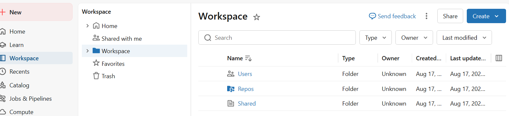

# AbAssurance / AssurePlus — Bloc 3
## Solution pédagogique 100 % Databricks Free Edition + Python/PySpark + GitHub

Ce dépôt propose une implémentation pédagogique du Bloc 3 du projet :
- Git : `main`, `develop`, branches `feature/*`, `fix/*`, etc.
- MCD cible commun aux deux SI
- ingestion de données sources
- architecture Bronze / Silver / Gold
- data cleaning
- data mapping
- rapprochement/déduplication clients
- tables de statistiques
- dashboard Databricks
- tests unitaires + coverage
- contrôle qualité du code
- identification et correction d'un bug d'idempotence

## Architecture

Oracle / SQL Server
        |
        | (production : JDBC/CDC)
        | (Free Edition : CSV simulant les exports)
        v
     Bronze Delta
        |
        v
     Silver Delta
  nettoyage + mapping
        |
        v
   matching clients
        |
        v
      Gold Delta
        |
        +--> statistiques
        +--> matrice de doublons
        +--> dashboard

## Exécution locale des tests

```bash
pip install -r requirements.txt
pytest --cov=src --cov-report=term-missing tests/
```

## Git

```bash
git init
git branch -M main
git checkout -b develop
```

Convention :
- `feature/<nom>`
- `fix/<nom>`
- `test/<nom>`
- `refactor/<nom>`
- `docs/<nom>`

## Databricks Free Edition

Dans la Free Edition, les fichiers CSV du dossier `data/sample` représentent les exports des deux bases sources.
En production, la couche d'ingestion pourra être remplacée par JDBC/CDC sans changer les transformations Silver/Gold.

## Important

Les noms et types du modèle cible sont une proposition de normalisation pédagogique à partir des deux schémas fournis dans l'énoncé.
Les règles métier de rapprochement doivent être validées par le client avant une fusion automatique des personnes.
## Execution du Notebook
### Principe
- Se connecter à DATABRICKS avec les identifiants fournis dans le PDF du Bloc 3.
.
- Cliquer sur Workspace
- Cliquer sur Users, puis sur kacidatabricks@gmail.com
- Choisir le projet : TEST_SONAR_GIT
- Cliquer encore sur TEST_SONAR_GIT
- Cliquer sur NOTEBOOKS
- Puis sur: Notbook_Projet_Big_Data_Assurance

Le Notebook est constitué de plusieurs cellules.
### Exécution concrête
il faut réescuter toutes les cellules à chaque passe.